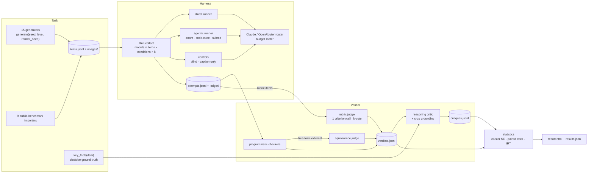

# VisionBench architecture: Task, Harness, Verifier

This document explains how VisionBench is built and why. It complements [METHODOLOGY.md](METHODOLOGY.md), which covers *what* is measured and the research behind it.



Everything between stages is an append-only JSONL file keyed by `model|mode|condition|uid|sample`. Any stage can be re-run, resumed or audited without re-querying a model.

---

## 1. Task

### 1.1 The generator contract

```python
class TaskFamily:
    name, version, skills, difficulties
    def build(rng, style, difficulty, noise_rng) -> {prompt, answer: AnswerSpec, images, facts, rubric?}
    def check(instance, parsed) -> (score, details)        # only for answer kind "custom"
```

`TaskFamily.generate(seed, difficulty, render_seed)` is a **pure function**: identical arguments produce byte-identical images, prompts and answers (enforced by `tests/test_families.py::test_deterministic`). Three random streams are kept separate:

| Stream | Seeded by | Controls |
|---|---|---|
| problem `rng` | family, seed, difficulty | the latent problem: layout, values, topology, the question |
| `style` | + render_seed | palette rotation, font family, stroke widths, paper tone, blur |
| `noise_rng` | + render_seed | sensor noise |

Because problem content never consumes style randomness, **a re-render changes only appearance**. All re-renders of a problem share a `cluster` id. That cluster drives two things:
1. the clustered statistics, since re-renders aren't independent evidence;
2. the **render-consistency** metric: a model that solves one rendering but fails a recoloured copy is pattern-matching, not reasoning.

`render_seed=0` is the canonical, noise-free rendering.

### 1.2 What makes an item valid

Each generator is responsible for proving its own item is **answerable, unambiguous and visual**:

| Family | Validity mechanism |
|---|---|
| `grid_rules` | Breadth-first enumeration of every program up to the item's depth, deduplicating intermediate states. The search covers the 23 generating primitives **plus 14 shadow rules**: plausible alternative readings (8-connectivity, per-object outlines, alternative tie-breaks, mirroring from the other half) that are never used to generate. The item is rejected unless *every* consistent program predicts the same test output. Each step of the hidden program must change at least one *example*, so no step can only be seen on the test grid. |
| `wire_tracing` | Rejects layouts where two curves stay within 5 px of each other for more than 8 consecutive samples (shallow-angle overlaps a human couldn't resolve). Draw order is randomized, so the wire on top isn't a cue. |
| `gear_train` | Non-adjacent gears must clear each other by at least 28 px, so accidental meshes can't happen. Belts are rejected if a tangent passes within 14 px of another gear. Decoy gears sit 16–26 px from their neighbour, a clearly visible gap. Teeth are phase-aligned so meshes look physically right. |
| `perspective_taking` | Objects within 15° of a decision boundary that matters for the question are excluded: the forward axis for left/right questions, the lateral axis for front/behind. |
| `block_stability` | Every interface's centre of mass must sit at least 0.15 units from a contact edge. Stable and unstable towers are balanced about 45/55. |
| `chart_reasoning` | Values sit exactly on gridlines. Ties in any argmax, mean comparison or condition are resampled away. Line series never coincide at a category, so markers can't hide each other. |
| `counting` | Occlusion is measured with pixel masks: no shape loses more than 25% of its area. Shapes are entirely inside or entirely outside the region box. |
| `clock_reasoning` | Hands are placed at their physical angles, with the hour hand advanced by minutes. Times where the hands overlap within 8° are rejected. |
| `cube_folding` | Only glyphs with no mirror symmetry are used (F G J L P Q R 4 7), so chirality stays observable. See 1.3. |
| `lattice_geometry` | Simple polygons only, with no collinear consecutive vertices (a vertex that isn't visible). Holes are verified inside the polygon with a margin. |

`visionbench selftest` and `tests/test_families.py::test_oracle_round_trip` generate items at every level, format the ground truth the way a model would, and require the verifier to accept it. This catches any mismatch between generator and verifier.

### 1.3 Two generators in detail

**Cube folding.** The net is folded by *rolling* a cube underneath the paper rather than by hinge geometry. The cube starts beneath the root cell with rotation `R = I`. Moving to a neighbour cell in direction `d` applies the rotation that maps `d → +z` and `+z → −d` (`roll_matrix`), so the face now touching the paper receives that cell's label. For each face it records the outward normal `Rᵀ·ẑ` and the glyph's "up" vector `Rᵀ·ŷ`. A view applies one of the 24 proper rotations and projects isometrically with the viewer at (+x, −y, +z). Glyphs are affine-warped onto each visible face: texture right = `up × n`, which keeps the outside reading direction correct. The conventions are unit-tested against physical reasoning; for a cross net, the flap above the centre becomes the back face with its glyph pointing down. Questions escalate:
1. opposite face (no chirality needed);
2. hidden right face given top and front (needs chirality);
3. all three hidden faces;
4. the faces on top and in front after a sequence of quarter turns, each turn composed as a rotation matrix.

**Grid rules.** The DSL has 23 primitives: geometric (flips, rotations, transpose), physical (gravity), topological (fill enclosed regions with colour c, hollow out, keep largest object), arithmetic (recolour by object size), colour (swap the two most frequent colours), symmetry completion, cropping, scaling, and rays from isolated pixels in 4 directions. Programs compose 1–3 distinct primitives. Uniqueness is checked over *states*, not program strings: two different programs that produce identical grids collapse to one state. That keeps depth-3 enumeration under a second.

### 1.4 Difficulty as a construct, not a filter

Difficulty levels are **generator parameters**, chosen to stress the family's named skill:

```
wire_tracing      wires 4→11 · control points 2→5 · same colour from L3 · queried wires 1→4
gear_train        gears 3→9 · belts 0→2 · crossed-belt probability 0→0.6 · decoys 0→2
maze_path         size 6→14 · extra loops 0→14% · keys 0→2
grid_rules        program depth 1→3 · grid 5→11 · examples 3→4
visual_search     width 1600→3600 px · tag font 22→12 px · colour-conditioned from L3
receipt_reasoning items 5→12 · line totals removed at L5 · voids, discount, tax, rotation
```

Nothing is filtered by asking a model whether it's hard. Adversarial filtering against particular models biases rankings against those models; Rasch difficulty is estimated *afterwards* across all subjects (§3.6).

### 1.5 Splits and contamination

`seed_for(split, i, secret)`:
- `dev`: seeds are `0..N-1`, publicly reproducible.
- `test`: seeds are `10⁷ + HMAC-SHA256(secret, "vb-test-i") mod 10¹²`.

Without the secret the test items can't be regenerated, and rotating the secret gives a fresh test set from the same generators. Family `version` strings go into the dataset manifest, so any generator change is visible.

### 1.6 Public benchmarks as Task sources

`visionbench/external/importers.py` converts Hugging Face datasets into the same `TaskInstance` schema:
- **Revisions are pinned** to the dataset commit SHA at import.
- **Sampling is stratified** by the dataset's own category field.
- **Option conventions** are normalized: letters, 0-based indices and options drawn inside the image all map to letter answers.
- **Chance level** is stored per item (`facts.chance`), so reports can show chance-normalized accuracy.

Scale AI's HSS keeps its rubric. Every criterion is marked critical, matching HSS's all-criteria-must-pass scoring.

### 1.7 Key facts

`visionbench/tasks/key_facts.py` maps each family's recorded `facts` to **at most 14 numbered, human-readable statements** a correct solution must perceive or derive. Examples:
- gears: the chain from the driver to the target with each link's type;
- receipts: the voided lines and category totals;
- clocks: the true time on the mirrored clock;
- graphs: the shortest path recomputed with Dijkstra, and each of its edges.

These are the reasoning critic's ground truth (§3.5). They let it separate a misreading from a mis-inference without guessing what is in the image.

---

## 2. Harness

### 2.1 The run loop

`Run.collect()` expands `models × items × conditions × samples` into jobs, skips keys already in `attempts.jsonl`, and runs the rest under a shared semaphore (`[run] concurrency`). Each completed attempt is appended immediately under an asyncio lock. Killing the process loses at most the attempts that were in flight.

Failures are recorded, not crashes:
- an API error becomes an attempt with `error=api_<status>`;
- 401/403 abort the run;
- errored attempts are **retried on resume** and **never scored**. An outage isn't a wrong answer.

Refusals are different: they are model behaviour, so they're kept and scored as `refusal`.

### 2.2 Model routing (`visionbench/llm.py`)

One interface, `create(model, messages, max_tokens, effort, system, tools, json_schema, fallbacks)`, two back ends:

| | Anthropic (bare model ids) | OpenRouter (`or:` prefix) |
|---|---|---|
| Transport | official SDK, streaming (`messages.stream` → `get_final_message`) | OpenAI-compatible chat completions |
| Thinking | `thinking: {type: adaptive, display: summarized}`; summaries logged | `reasoning: {effort}`; reasoning text logged when the provider returns it |
| Effort | `output_config.effort` | mapped to low/medium/high |
| Structured output | `output_config.format` JSON schema | `response_format: json_schema (strict)` |
| Refusals | `stop_reason == "refusal"` + `stop_details.category` | `finish_reason == "content_filter"` |
| Cost | tokens × configured price | provider-reported `usage.cost` |
| Budget | none | hard stop at `[openrouter] budget_usd`; the run halts cleanly |

Subjects run **without** server-side refusal fallback, since a fallback would attribute another model's answer to the subject. Judges run *with* it, since a substituted judge doesn't change what is measured.

### 2.3 Prompt protocol

Prompts are identical across models (`harness/prompting.py`). The direct protocol asks for three things in order:
1. the key observations the answer depends on, briefly;
2. the answer inside `<answer>` tags, in the item's `format_hint`;
3. a 0–100 probability inside `<confidence>`.

Observations are requested because the reasoning critic needs visible evidence. The request is deliberately short: asking a model to write out its full reasoning invites verbosity and, on some models, `reasoning_extraction` refusals. Confidence enables calibration metrics.

### 2.4 Image policy

`harness/images.py` resizes every image to fit `max_image_side` (1568 by default) with Lanczos resampling. It uses PNG, switching to JPEG q92 above 4.5 MB. The original and sent sizes are logged per attempt. Resolution is therefore a fixed, documented condition, not a hidden variable. O3-Bench measured about 10 points of swing from resolution alone. `visual_search` deliberately exceeds the cap (up to 3600 px), so it measures whether an agent zooms.

### 2.5 Agentic mode

A manual tool loop (`SubjectRunner.run_agentic`) with three tools:

- **`zoom(image_index, x0, y0, x1, y1)`**: coordinates are in *original* pixels, and the prompt states each image's original and shown sizes. Crops are upsampled up to 4× within the size cap and returned as image `tool_result`s. Every crop is saved to `ledger/` and its box logged, which makes deterministic grounding analysis possible (§3.5).
- **`code_execution`** (optional, Anthropic server-side): images are uploaded through the Files API as `container_upload` blocks, and the container id carries across turns.
- **`submit_answer(answer, confidence)`**: ends the attempt. Forced `tool_choice` isn't available on current Claude models, so the prompt instructs the call. A turn that ends without it gets one nudge, and a tagged answer in plain text is also accepted.

The loop is append-only: assistant content goes back verbatim, which preserved thinking requires. `pause_turn` is resumed. Budgets are `max_turns`, plus `max_tokens` per turn.

### 2.6 Controls

| Condition | What the subject gets | Question it answers |
|---|---|---|
| `vision` | image(s) + question | the measurement |
| `blind` | question only, with an explicit "image unavailable, guess anyway" | is the item solvable from language priors? |
| `caption` | a dense, *question-agnostic* caption written by the judge model, then the question, text only | how much of the task survives verbalization? |

Each control runs on the *same items* as `vision`, so the gap is a paired difference with its own confidence interval.

### 2.7 Offline subjects and humans

- **Mock subjects** (`mock:oracle`, `mock:noisy-p`, `mock:guess`) produce ground-truth-formatted or perturbed answers with no API calls. The full pipeline (collect → verify → statistics → report) is tested end to end in CI.
- **Human baselines:** `visionbench human-form` builds a self-contained HTML answer sheet, sampled one rendering per problem and stratified over family × level, with per-item timing and confidence. `human-import` appends the answers as subject `human:<name>`, so people are verified and reported exactly like models.

---

## 3. Verifier

Verification is layered in order of trust. Each verdict records which layer decided it.

### 3.1 Layer 1: programmatic checkers (`verifiers/answers.py`)

**Extraction:**
- the *last* `<answer>` block is used, falling back to a "final answer:" line;
- the method is logged as `tag`, `fallback` or `none`;
- agentic attempts use the `submit_answer` argument.

**Checking by `AnswerSpec.kind`:**

| Kind | Rule | Partial credit |
|---|---|---|
| `integer` / `number` | single parsed value, with fractions allowed (`75/2`); several distinct numbers → `unparseable` | — |
| `choice` | exactly one distinct option letter | — |
| `text` | normalized: lowercase, punctuation and filler words removed | — |
| `set` | exact set equality | F1 |
| `mapping` | every key must match | fraction of keys correct |
| `grid` | exact; a shape mismatch scores 0 | cell accuracy |
| `custom` | the family's own **solution checker** | family-defined |

Two solution checkers matter most:
- **Maze:** simulates the submitted move string through the actual walls, tracks key cells, and accepts *any* path of optimal length. Answer-matching would wrongly fail models whenever several shortest paths exist.
- **Gears:** parses direction and rpm independently, with fractions allowed, and handles "stationary".

`unparseable` is kept separate from `incorrect`. Both score 0, but they're reported apart, so formatting failures are never mistaken for reasoning failures.

### 3.2 Layer 2: reference-guided equivalence (external free-form only)

When a public benchmark's free-form answer fails the programmatic check, a judge compares the response with the reference ("0.5 m" vs "1/2"). The programmatic outcome is kept in `details.programmatic_outcome`, so the report can show strict and lenient numbers. Procedural families never use this layer: their answers are typed by construction.

### 3.3 Layer 3: rubric judge (open-ended items)

Used by `chart_insight` and Scale's HSS:
- **Atomic, binary criteria:** each one is generated from ground truth, for example "identifies the level shift near t=42 (±4)".
- **One criterion per call:** the judge never trades criteria off against each other.
- **k samples per criterion (default 3), majority vote,** with per-criterion agreement logged.
- **Reference facts in context:** grading is reference-guided, which aligns with human graders far better than reference-free judging.
- **Critical criteria gate the pass:** `chart_insight` has a critical *no-fabrication* criterion, so listing every possible anomaly can't score.
- **Score:** the weighted fraction of criteria met. A pass needs every critical criterion met *and* a score of at least 0.8.

### 3.4 Layer 4: auditing the judges

- **`visionbench judge-audit`:** runs the equivalence judge on a class-balanced sample of *programmatically verified* attempts, which serve as gold labels at no extra cost. It reports accuracy, Cohen's κ, sensitivity and specificity. It also reports the **false-accept rate** separately: a lenient judge looks fine on overall agreement while waving wrong answers through.
- **`visionbench critique-audit`:** re-runs the reasoning critic on the same attempts and reports test-retest agreement for each judgment.

### 3.5 Layer 5: reasoning critique (how the agent reasoned)

`visionbench critique <run>` sends the critic:
- the task and the image;
- the item's numbered key facts;
- the correct answer and the programmatic grade;
- the agent's visible work: its answer, its observations, its reasoning summary, and its tool calls with their arguments.

The critic returns a strict JSON object (schema `CRITIQUE_SCHEMA`):

```
observations[]   {claim, verdict: correct | incorrect | unverifiable}   every concrete image claim the agent made
key_facts[]      {index, status: stated_correctly | stated_incorrectly | not_mentioned}
reasoning_valid, answer_supported, self_verification            booleans
first_error_step, error_type (13-way taxonomy), strategy (8-way), efficiency
strengths, weaknesses, critique                                  free text for the report
```

`verifiers/reasoning.py::derive` turns this into metrics:

| Metric | Definition |
|---|---|
| claim precision | correct claims ÷ (correct + incorrect claims): how much of what it said about the image is true |
| key-fact recall | key facts stated correctly ÷ all key facts: what it actually perceived |
| key-fact misread rate | key facts stated incorrectly ÷ key facts mentioned |
| sound success | graded correct **and** reasoning valid **and** answer supported |
| unsupported success | graded correct but not earned: a guess, or wrong steps that happened to land right |
| failure locus | `perception` if any key fact was misread or the first error is perceptual (misread, omission, hallucination, binding, tracking, counting); `instruction`; `no_answer`; otherwise `reasoning` |

For agentic runs, `crop_grounding` adds a **deterministic** grounding measure: the share of gold evidence boxes (from `visual_search`) at least half covered by some crop, the crop count, and the crop area relative to the image. Accuracy is then split by whether the agent inspected all of the evidence.

`analysis/reasoning_profile.py` aggregates these into a profile per agent:
- standard errors on every rate;
- strategy and efficiency mix;
- accuracy with vs without self-verification;
- failure locus and error taxonomy;
- breakdown by family;
- **head-to-head** analysis: on items where A is right and B is wrong, the distribution of B's first errors, and vice versa;
- example critique cards with item thumbnails.

### 3.6 Self-audit of items: cross-vendor consensus

`aggregate.consensus_wrong` flags every item where models from **two or more different vendors give the identical wrong parsed answer**. Independent systems converging on the same "wrong" answer is the strongest automatic evidence that the key or the item is at fault rather than the models. The report lists these items for human review next to the IRT suspect keys and the blind-solvable items.

In the first live run this check found a real ambiguity. In `grid_rules` v1, the `outline` primitive hollowed out touching objects of *different* colours as one mass, and models from three vendors agreed on the per-object reading. The fix is the shadow-rule mechanism in §1.2, released as `grid_rules` v2.

### 3.7 Statistics (`analysis/stats.py`)

Statistics follow Miller (2024), "Adding Error Bars to Evals", and later practice:

1. **Unit of analysis:** the item. Its *k* samples are averaged first and never pooled.
2. **Clustered SE:** `Var = C/(C−1) · Σ_c (Σ_{i∈c}(xᵢ − x̄))² / n²`, with clusters being latent problems (re-renders) or source items. The cluster count is always reported. A unit test checks that clustered SE exceeds the naive SE when re-renders are correlated.
3. **Bootstrap CIs:** 2,000 resamples of clusters (ratio estimator: sum of scores ÷ sum of items).
4. **Paired comparisons:**
   - mean per-item difference on shared items, with clustered SE and bootstrap CI;
   - a **sign-flip permutation test** at the cluster level, 5,000 permutations;
   - **Holm** correction across all pairs;
   - the correlation between the two models' item scores;
   - **minimum detectable effect** ≈ 2.8 × SE at 80% power.
5. **Rank intervals:** joint cluster bootstrap across models; the 2.5–97.5% rank quantiles are reported.
6. **pass@k / pass^k:** unbiased combinatorial estimators, `1 − C(n−c,k)/C(n,k)` and `C(c,k)/C(n,k)`.
7. **Calibration:** 10-bin ECE, Brier score, and overconfidence (mean confidence − accuracy).
8. **Item analysis:**
   - an L2-regularized joint-MLE **Rasch** fit gives family difficulty;
   - **suspect keys:** the strongest subject fails every sample while others pass at least half the time;
   - **blind-solvable items:** blind accuracy of at least 50%.

### 3.8 Report

`analysis/report.py` writes a single self-contained HTML file: inline SVG, no external assets, light and dark themes. It covers:
- leaderboard with confidence intervals;
- family heatmap;
- difficulty curves;
- vision / caption / blind bars and gap table;
- calibration curves;
- paired-comparison table;
- outcome breakdown;
- reasoning analysis;
- reliability;
- item-quality audit;
- per-item drilldown.

Every chart has a table next to it and hover tooltips. Colours follow the subject, not its rank, so filtering never repaints a model. `results.json` holds every number for downstream use.

---

## 4. Extending VisionBench

| To add… | Do this |
|---|---|
| a task family | subclass `TaskFamily`, `@register`, import it in `tasks/families/__init__.py`; add a key-facts function; the oracle test then runs automatically |
| a public benchmark | write `def source(hub, limit, seed)` yielding `make(...)`, then add it to `SOURCES` |
| a model provider | add a branch to `Claude.create` that returns an `LLMResult` |
| an answer type | add a kind to `AnswerKind` and a branch in `answers.check`; add a formatter to `mock.format_truth` |

## 5. Design trade-offs

- **Synthetic images versus natural images.** Synthetic images give exact ground truth, unlimited fresh items and controllable difficulty. They can also measure a "synthetic-render skill". That's why the public real-image track and the correlation check exist.
- **One critique sample versus k.** The critic runs once per attempt to control cost; `critique-audit` quantifies the noise this leaves.
- **Visible reasoning only.** Providers expose summaries, not raw chains of thought, so the critique judges what the agent showed. This is reported as a limitation, not hidden.
- **Same-family judging.** Grounding every judgment in generator facts limits self-preference. Using a judge from a different family than the subject (configurable with `[judge] model`) removes it.
